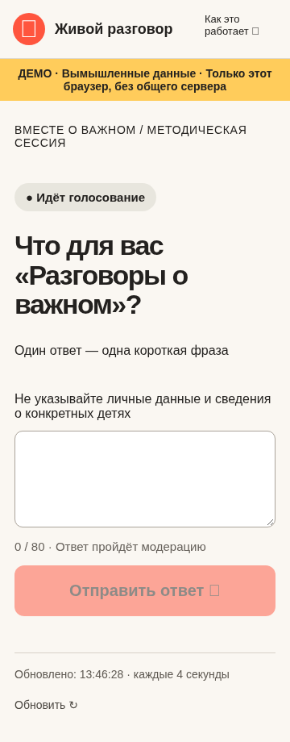
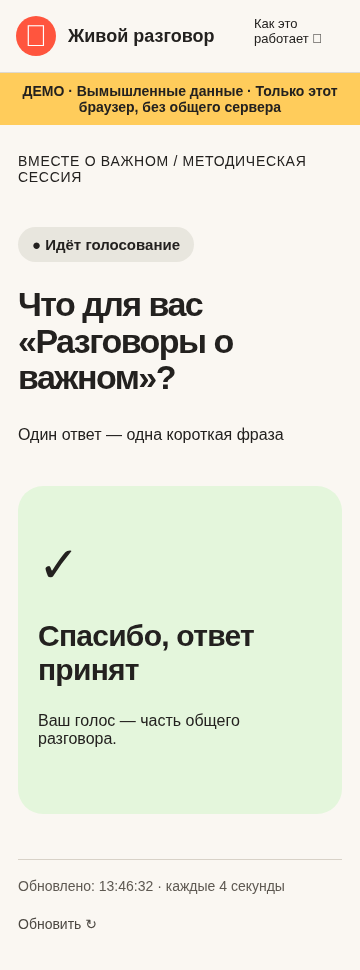
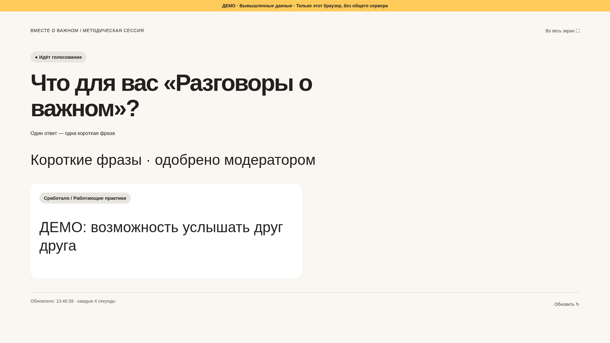
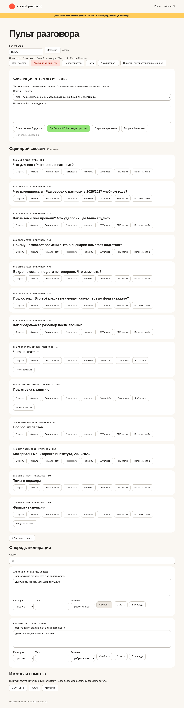

# Живой разговор

Интерактивная доска сессии «Вместе о важном», 12 ноября 2026, 10:00–11:30 (Europe/Moscow). React + TypeScript + Vite; Supabase PostgreSQL, Auth, RLS и polling раз в 4 секунды. Приоритет — [сценарий версии 2](docs/scenario.md). Существующие анкета doforuma и Google-таблица не подключаются и не изменяются.

## Локальный запуск

Нужны Node.js 24 и npm 11. Из корня репозитория:

```sh
npm ci
npm run dev -- --port 5173
npm run build
npm test
npm run test:db
npm run test:e2e
```

Без `.env.local` работает **ДЕМО**, изначально без ответов и диаграмм. Демо хранится в localStorage только одного браузера; две вкладки видят общие данные, разные устройства — нет. Для практики введите явно вымышленные ответы; кнопка очистки возвращает пустое демо. Демо не отправляет данные в Supabase. Очистка браузера удаляет демо. Сессия участника в демо — sessionStorage; в production — Supabase Auth.

Маршруты: `/join/DEMO`, `/screen/DEMO`, `/admin`, `/help`. В production замените DEMO кодом созданного события. Главная страница содержит ссылки на демо, которые в production не используются; реальный код сообщает организатор. Локальные адреса не являются публичным развёртыванием.

## Supabase из чистого аккаунта

1. Создайте проект. В SQL Editor выполните `supabase/migrations/001_board.sql`, затем **один раз** `supabase/seed.sql`. Миграция рассчитана на новую схему; повторное применение не предусмотрено. Seed создаёт пустое событие с непредсказуемым кодом и 13 экранами, без придуманных результатов. Сохраните выведенные UUID и код.
2. В Authentication включите Anonymous Sign-ins. Создайте отдельные подтверждённые аккаунты организаторов (email/password); выключите публичную email-регистрацию, если она не нужна. Участникам почта/пароль не нужны. Анонимное включение не отменяет аккаунты организаторов.
3. В SQL Editor назначьте первому организатору `admin_roles`: пример в конце seed. Остальным назначьте `operator` или `moderator` с UUID того же события. Секретарь-оператор записывает слова зала и управляет показом; модератор утверждает/редактирует ответы; администратор настраивает событие, вопросы, импортирует и экспортирует. Участник не может самостоятельно назначить роль. Управление аккаунтами и ролями доступно владельцу проекта через Dashboard, не публичному клиенту.
4. Скопируйте `.env.example` в `.env.local`. Задайте `VITE_SUPABASE_URL` и публичный `VITE_SUPABASE_ANON_KEY` (legacy anon key или совместимый publishable key). **Никогда не помещайте service_role, secret key или пароль БД в VITE-переменные.** Обе переменные должны быть заданы вместе; конфигурационные ошибки не переключают приложение в демо.
5. Выполните сборку, войдите в `/admin`, введите код события. Откройте первый вопрос. С двух телефонов отправьте тестовые фразы в отдельном тестовом событии; убедитесь, что их нет на экране до одобрения. После прогона удалите тестовое событие через SQL Editor. Не используйте настоящее событие для нагрузки.

Ключи и пароли не включены в репозиторий. Для сети среды понадобятся домен вашего проекта `<project-ref>.supabase.co` и домен опубликованного frontend. В настройках облачной среды добавляйте конкретные домены к существующему списку, не заменяя его. Для текущего локального демо эти доступы не требуются.

## Развёртывание

В Vercel импортируйте GitHub-репозиторий, Framework Vite, build `npm run build`, output `dist`. Для Netlify: те же build/output, `public/_redirects` скопируется в dist. `vercel.json` задаёт SPA fallback. В настройках сборки задайте публичные VITE-переменные. После получения **настоящего HTTPS URL** задайте `VITE_PUBLIC_ORIGIN` этому origin без пути и повторите сборку. QR появится только при корректном HTTPS origin; он ведёт на `/join/:code`, никогда на админку. Вручную проверьте URL телефоном: приложение не может само доказать, что настроенный origin опубликован. Добавьте адрес frontend в Supabase Auth URL configuration. Проверяйте прямое открытие каждого маршрута, а не только переход с главной.

В этой сессии публичный URL не создан, удалённый Supabase не настроен и push в GitHub не выполнен. Рабочая копия содержит исходники для проверки и последующей публикации; ни аккаунты, ни их доступность не выдуманы.

## Пять кликов перед сессией

1. Войти в `/admin`.
2. Загрузить код настоящего события.
3. Открыть первый короткий вопрос.
4. Открыть ссылку «Проектор».
5. Включить полный экран и проверить ответ телефона через модерацию.

Далее закройте цифровой вопрос. Для устных блоков оператор вводит **реально произнесённые** фразы в «Фиксацию ответов из зала», выбирает категорию и отправляет в очередь. Модератор утверждает, оператор нажимает «Показать итоги» нужного блока. Смена активного вопроса закрывает предыдущий. «Скрыть экран» прячет доску; «Аварийно закрыть всё» также прекращает приём. Клиенты увидят изменение при следующем успешном запросе (до 4 секунд плюс сеть); мгновенный отзыв уже загруженного экрана без связи невозможен.

## Три источника и импорт

- `live`: одна фраза до 80 символов в начале, положительная, нейтральная или критическая. Ручная модерация; максимум 10 карточек.
- `oral`: шесть устных вопросов. Никаких процентов и N. «Сработало / Было трудно» — отдельные колонки; категории остальных реплик помечены на карточках. Проектор показывает последние 10 одобренных; чтобы отобрать 6–10 разных, скройте лишние/повторные. Перенос между категориями и исправление текста проходят через модерацию.
- `preforum`: три отдельных блока анкеты. Исходные строки, коды ответов и контакты не импортируются. Организатор вручную исключает пробные строки 2–8 и любые другие тесты, не полагаясь только на цвет. Пока N не задан, экран честно сообщает «Ожидаем результаты опроса».

Для диаграммы сначала задайте 2–6 категорий через «Изменить» пустого вопроса. CSV: `категория;число`, далее точные названия вариантов и целые числа; переносов строк внутри названий нет. После выбора файла введите N реальных ответов, время среза и описание выборки. JSON-формат показан в `docs/aggregate-example.json`: UUID вариантов возьмите из администраторского JSON-экспорта. Файл-пример не является данными форума. Сумма счётчиков одиночного выбора обязана совпадать с N; импорт принимается только в пустой вопрос, повтор запрещён. Исходная анкета может содержать иные типы данных: не сводите многозначные ответы к одиночному выбору без редакторского решения. Для третьего вопроса вручную внесите обезличенные редакторские тексты через форму фиксации, выбрав источник `preforum`; они тоже ожидают модерации.

Мониторинг Института — отдельный экран. До подтверждения источника и методологии в «Источник / слайд» значения не показываются. После подтверждения: 60→77, 68→75, 79→94 — только позитивное отношение; полезность с этим не объединяется. Значения взяты из ТЗ, внешняя методология в этой сессии не проверялась.

«Темы и подходы» содержит исходные подписи из ТЗ, редактируемые через «Источник / слайд». Для СПО 2–4 курсов общий блок не используется. Ввод мнений педагогов — через очередь модерации. «Фрагмент сценария» принимает один PNG/JPG до 2 МБ, без генерации значков и расшифровок. Изображение хранится в метаданных БД и включается в экспорт; используйте только обезличенный утверждённый фрагмент. На проекторе доступны увеличение и прокрутка. Для большого файла лучше отдельный защищённый процесс подготовки изображения, текущий лимит не повышайте без измерений.

## Экспорт, резерв и удаление

CSV — UTF-8 BOM, разделитель `;`, кавычки и защита от формул Excel. Экспорт содержит event_id, вопрос, источник, время, категорию, статус, текст/вариант, счётчик, теги и экспертный статус «решено / требуется ответ». JSON содержит полную административную доску, включая историю модерации без идентификатора аккаунта модератора. Markdown группирует по трудностям, практикам, решениям и вопросам, сохраняя источники и время. Эти файлы доступны администратору; перед передачей редактору нужна проверка текста. Это рабочая основа памятки, не автоматическая публикация рекомендаций.

У каждого вопроса есть PNG/CSV для плана Б. Для устного экрана PNG включает одобренные фразы без N; длинные тексты могут сжиматься — проверьте читаемость и вставьте картинки в резервный PPTX **до форума**. Для экранов мониторинга, сравнения и реального фрагмента используйте проверенные исходные слайды; автоматическое формирование PPTX не реализовано. При сбое сети — 4–5 ответов голосом, жестовое голосование и бумага/локальный файл. Полностью offline backend не реализован.

Перед мероприятием сделайте резервную копию PostgreSQL средствами Supabase/pg_dump с защищённым хранением и проверьте восстановление в отдельном проекте. JSON/CSV — редакторский экспорт, а не замена полной копии БД и Auth. Согласуйте срок хранения, затем установите `events.delete_after` (например, дата события + 30 дней). Настройте Supabase Cron от postgres: `delete from public.events where delete_after < now();` — каскадно удаляются вопросы, голоса, тексты и аудит. По умолчанию автоматическое удаление **не включено**, срок не подтверждён организатором. Отдельно удаляйте ненужных анонимных пользователей Auth через поддерживаемый Dashboard/Admin API и управляйте сроком хранения резервов и инфраструктурных логов.

## Безопасность и границы проверки

На семи таблицах включена RLS; нет разрешающих политик и прямых прав anon/authenticated. Только scoped SECURITY DEFINER RPC с фиксированным search_path: публичная доска возвращает активные вопросы, агрегаты при показе итогов и одобренные карточки. Голоса и идентичности не возвращаются. Private helpers недоступны через публичный API. Проверки статуса, принадлежности вопроса событию и вариантов — в БД. Уникальность `(poll_id, anonymous_session_id)` обеспечивает идемпотентный повтор в одной Supabase-сессии. Закрытие синхронизировано с вставками блокировками. Для исходных/исправленных текстов ведётся закрытый аудит. JSON содержит его для администратора.

Rate-limit: минимум 2 секунды между новыми ответами одной идентичности, максимум 30/час. Это не защита от ботов, создающих новые Auth-сессии; настройте лимиты Anonymous Sign-ins, квоты и при необходимости CAPTCHA на уровне Supabase до публичного анонса. CAPTCHA-интеграция в интерфейсе пока отсутствует. Устройства/очистка браузера обходят случайное ограничение повторов. Приложение не сохраняет IP/user-agent/геолокацию/имена; провайдеры могут вести инфраструктурные логи — настройте их отдельно. Добровольная контактная форма фокус-группы не реализована, поскольку отдельного согласования нет.

`npm test`: 4 теста модели/экспорта. `npm run test:db`: реальный PostgreSQL в WASM (PGlite), grants/RLS, две идентичности, повтор, модерация, аудит, роли, закрытие и 350 вставок за 25 секунд. Результаты: [docs/db-results.json](docs/db-results.json). Это не измерение HTTP, Supabase Auth, 350 подключений телефонов или Wi-Fi. Для удалённого одноразового тестового события есть `scripts/load-supabase.mjs` (переменные перечислены в начале); создаёт 350 анонимных тестовых аккаунтов, отправляет по одной фразе и сообщает реальные ошибки/задержки. Он здесь не запускался. Проверьте тариф/лимиты регистрации заранее и удалите тестовые аккаунты после прогона.

Playwright использует системный Chromium (`CHROMIUM_PATH` переопределяет путь), проверяет демо с двумя участниками, очередь, скрытие, устную запись и отсутствие горизонтальной прокрутки на 360×780. Скриншоты ниже получены автоматически на вымышленных фразах. До форума нужны отдельный полный прогон в настоящем Supabase, реальные телефоны, сеть зала, утверждение источников, изображения, логотипа и читаемости с последних рядов. Брендовые цвета взяты из ТЗ; сам брендбук и лицензированные файлы PT Root UI не предоставлены, используется системный sans-serif.

## Скриншоты демо





